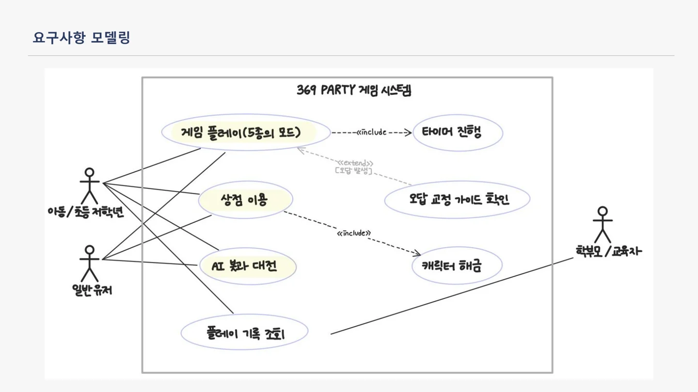
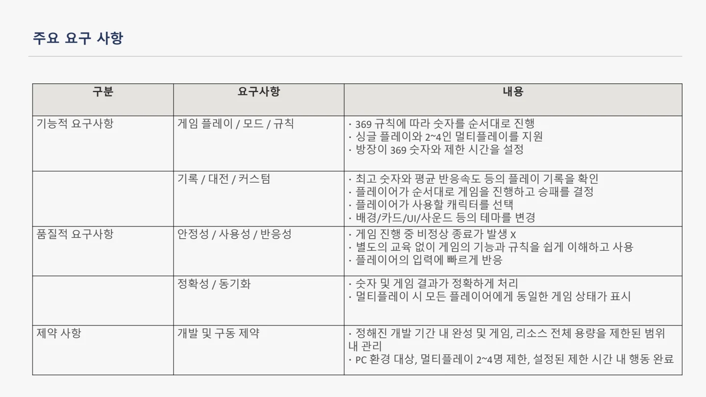
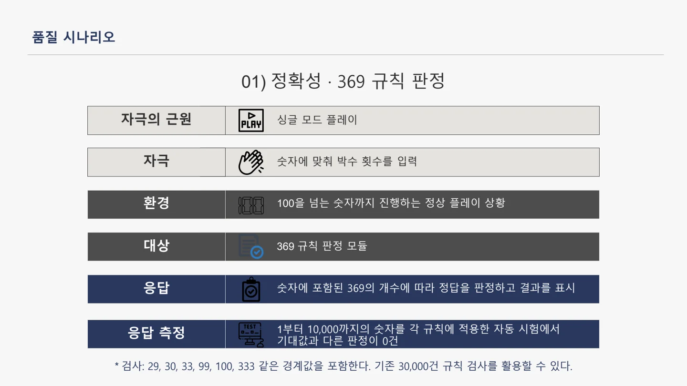
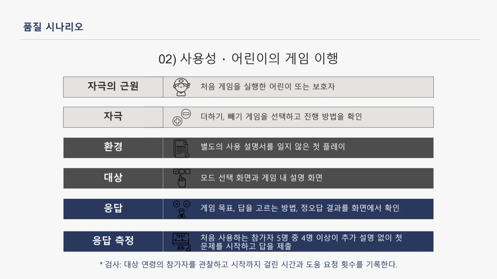

##### 369 규칙과 숫자 학습을 싱글 플레이와 파티 대전으로 즐길 수 있는 PC 게임입니다.

  

#### 기능적 요구사항

* 369 규칙에 따라 숫자를 순서대로 진행해야 한다.
* 싱글 플레이와 2~4인 멀티플레이를 지원해야 한다.
* 방장은 369 숫자와 제한 시간을 설정할 수 있어야 한다.
* 최고 숫자와 평균 반응속도 등 플레이 기록을 확인할 수 있어야 한다.
* 플레이어가 순서대로 게임을 진행하고 승패를 결정해야 한다.
* 플레이어가 사용할 캐릭터를 선택할 수 있어야 한다.
* 배경·카드·UI·사운드 등의 테마를 변경할 수 있어야 한다.

#### 품질적 요구사항

* 안정성 · 게임 진행 중 비정상 종료가 발생하지 않아야 한다.
* 사용성 · 별도의 교육 없이 게임의 기능과 규칙을 쉽게 이해하고 사용할 수 있어야 한다.
* 반응성 · 플레이어의 입력에 빠르게 반응해야 한다.
* 정확성 · 숫자와 게임 결과가 정확하게 처리되어야 한다.
* 동기화 · 멀티플레이 시 모든 플레이어에게 동일한 게임 상태가 표시되어야 한다.

#### 품질 시나리오의 응답척도

* 정확성 시나리오 · 1~10,000 숫자에 각 규칙을 적용하는 자동 시험에서 기대값과 다른 판정이 0건이어야 한다.
* 사용성 시나리오 · 처음 사용하는 참가자 5명 중 4명 이상이 추가 설명 없이 첫 문제를 시작하고 답을 제출할 수 있어야 한다.

#### 제약사항

* 정해진 개발 기간 안에 완성하고 게임과 리소스의 전체 용량을 제한된 범위 내에서 관리해야 한다.
* PC 환경을 대상으로 하며 멀티플레이 인원은 2~4명으로 제한한다.
* 플레이어는 설정된 제한 시간 안에 행동을 완료해야 한다.

품질 수치는 제출자료에 제시된 개발 목표이며, 구현 완료 또는 실측 달성을 뜻하지 않습니다.

 

#### UseCase Diagram

 

#### 발표자료

* [중간발표 자료 PDF 보기](/documents/2026/369-party/presentation.pdf)
* [원본 PowerPoint 다운로드](/documents/2026/369-party/presentation.pptx)

요구사항 출처 확인

기능·품질·제약: 7번 슬라이드. 상세 품질 시나리오: 10~11번 슬라이드.

7번 슬라이드 원문 보기

10번 슬라이드 원문 보기

11번 슬라이드 원문 보기

