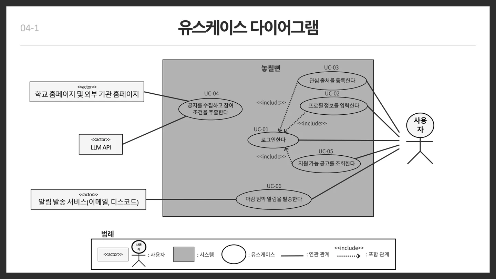
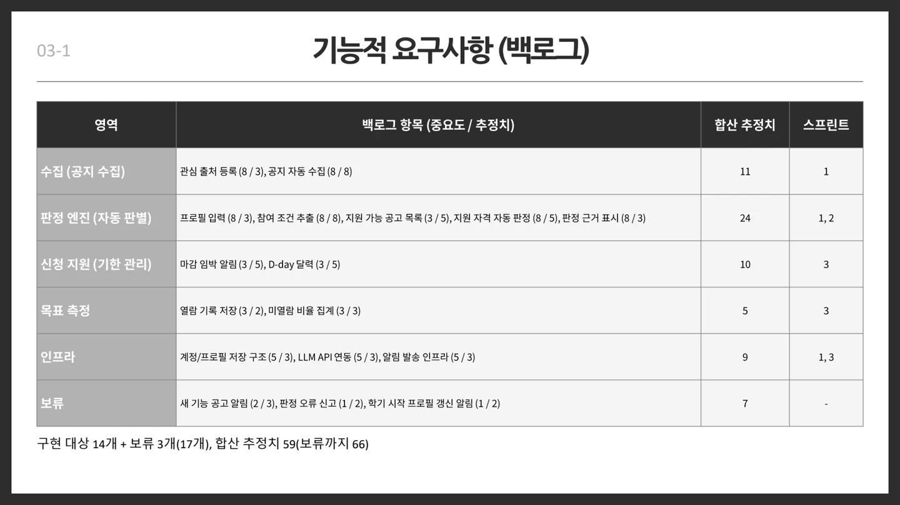
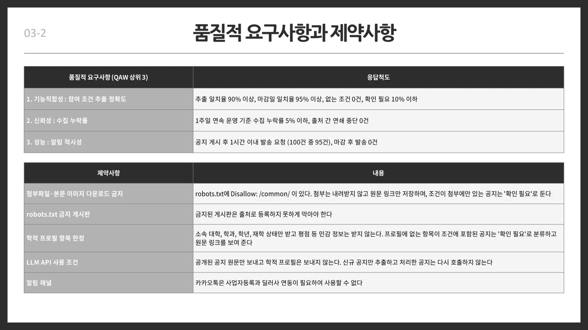
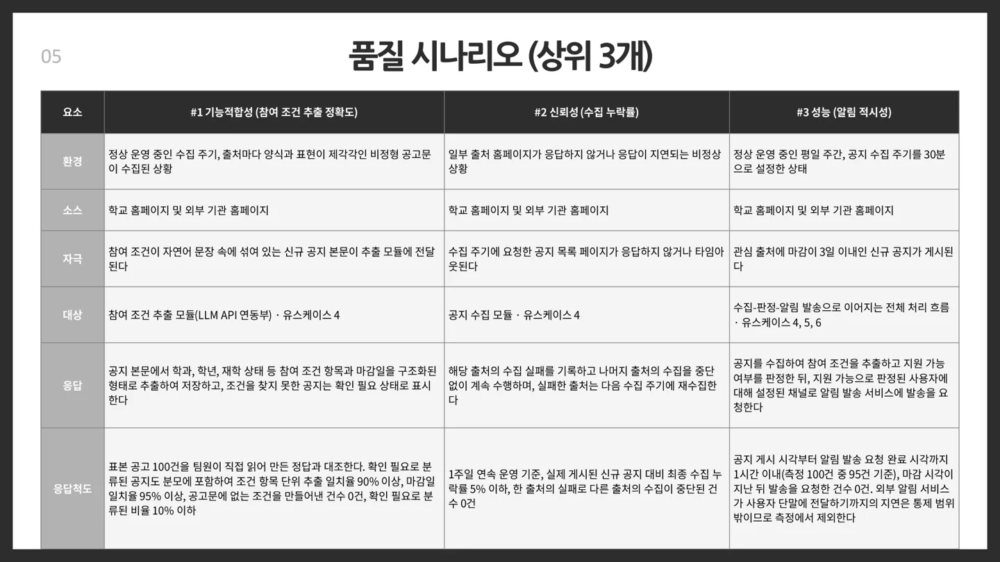

##### 경상국립대 재학생의 프로필과 공지의 참여 조건을 비교해 지원 가능 여부와 근거를 제공하고 마감 임박 알림을 보내는 서비스입니다.

  

#### 기능적 요구사항

* 사용자가 관심 공지 출처를 등록하고 시스템이 신규 공지를 자동 수집해야 한다.
* 소속 대학·학과·학년·재학 상태 등 학적 프로필을 입력하고 저장할 수 있어야 한다.
* LLM API로 공지의 참여 조건을 추출하고 사용자 프로필과 비교해 지원 자격을 자동 판정해야 한다.
* 지원 가능 공고 목록과 항목별 판정 근거를 표시해야 한다.
* 마감 임박 알림과 D-day 달력으로 신청 기한을 안내해야 한다.
* 열람 기록을 저장하고 마감까지 미열람한 공지의 비율을 집계해야 한다.
* 계정·프로필 저장 구조, LLM API 연동, 알림 발송 인프라를 제공해야 한다.

#### 보류·확장 범위

* 새 공고 알림, 판정 오류 신고, 학기 시작 프로필 갱신 알림은 보류 항목이다.

#### 품질적 요구사항

* 기능적합성 · 참여 조건 항목 단위 추출 일치율 90% 이상, 마감일 일치율 95% 이상이어야 한다.
* 원문에 없는 조건 생성은 0건, ‘확인 필요’ 분류 비율은 10% 이하여야 한다.
* 신뢰성 · 1주일 연속 운영 기준 수집 누락률은 5% 이하이며, 한 출처의 장애가 다른 출처의 수집을 중단시키지 않아야 한다.
* 성능 · 마감 임박 신규 공지 100건 중 95건은 게시 후 1시간 이내에 알림 발송을 요청해야 하며 마감 후 발송 요청은 0건이어야 한다.

#### 제약사항

* 첨부파일과 본문 이미지는 다운로드하지 않고 원문 링크만 저장해야 한다. 조건이 첨부에만 있으면 ‘확인 필요’로 분류해야 한다.
* robots.txt가 금지한 게시판은 출처로 등록하지 못하게 해야 한다.
* 학적 프로필은 소속 대학·학과·학년·재학 상태로 한정하고 평점 등은 받지 않아야 한다. 프로필에 없는 조건은 ‘확인 필요’로 안내해야 한다.
* LLM에는 공개된 공지 원문만 보내고 학적 프로필은 보내지 않아야 한다. 처리한 공지는 다시 호출하지 않아야 한다.
* 알림 채널은 이메일·디스코드를 사용한다. 제출자료에서는 사업자등록·딜러사 연동 제약 때문에 카카오톡을 제외했다.

품질 수치는 제출자료에 제시된 개발 목표이며, 구현 완료 또는 실측 달성을 뜻하지 않습니다.

 

#### UseCase Diagram

 

#### 발표자료

* [중간발표 자료 PDF 보기](/documents/2026/almost-missed/presentation.pdf)
* [원본 PowerPoint 다운로드](/documents/2026/almost-missed/presentation.pptx)

요구사항 출처 확인

기능·보류 항목: 5번 슬라이드. 품질·제약: 6번 슬라이드. 품질 응답척도: 9번 슬라이드.

5번 슬라이드 원문 보기

6번 슬라이드 원문 보기

9번 슬라이드 원문 보기

