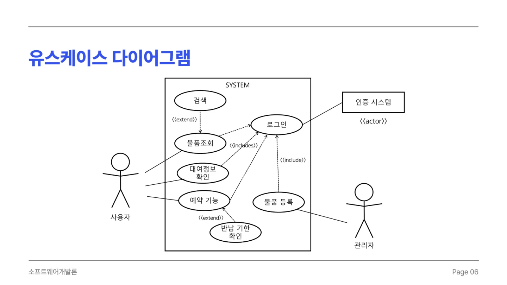
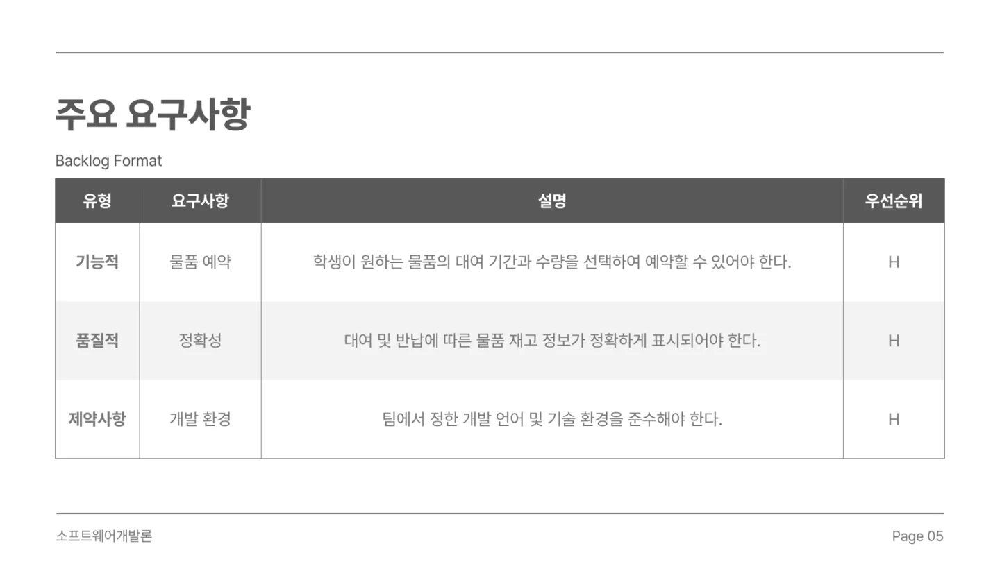
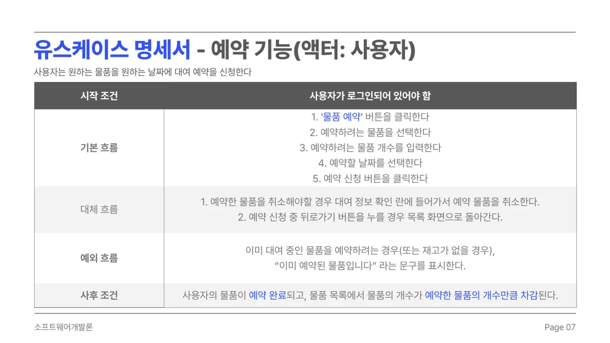
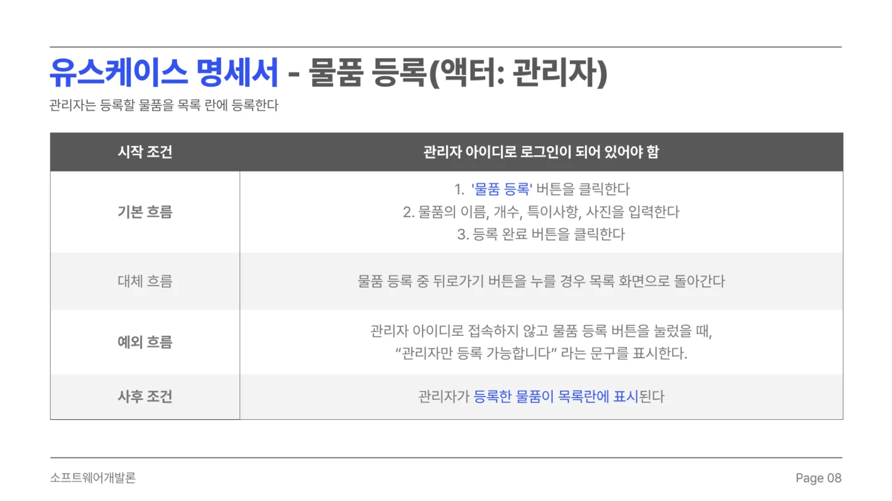
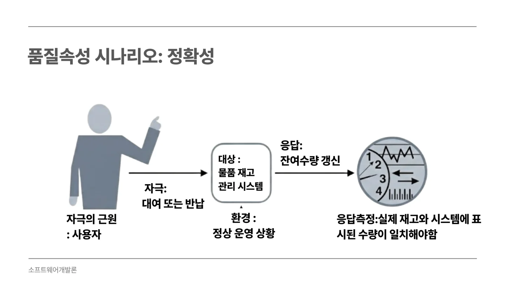
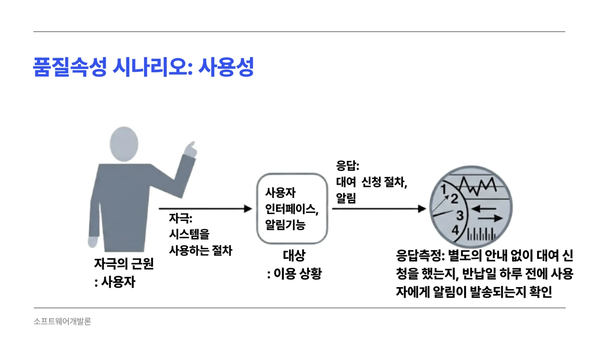
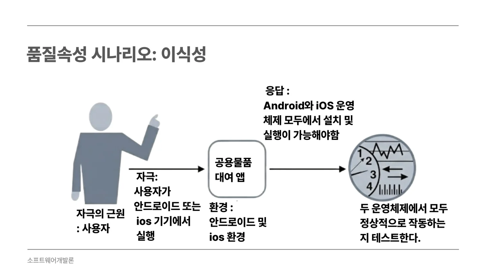

##### 교내 공용물품의 재고를 확인하고 대여 기간과 수량을 선택해 예약할 수 있는 대학생 공용물품 대여 서비스입니다.

  

#### 기능적 요구사항

* 학생이 원하는 물품의 대여 기간과 수량을 선택하여 예약할 수 있어야 한다.

#### 유스케이스에 명시된 기능

* 사용자는 로그인 후 물품 검색·조회, 대여 정보 확인, 예약 취소를 할 수 있어야 한다.
* 관리자는 물품 이름·개수·특이사항·사진을 입력하여 물품을 등록할 수 있어야 한다.

#### 품질적 요구사항

* 정확성 · 대여 및 반납에 따른 물품 재고 정보가 정확하게 표시되어야 한다.
* 사용성 · 사용자가 별도의 안내 없이 대여 신청을 할 수 있어야 한다.
* 사용성 시나리오 · 반납일 하루 전에 사용자에게 알림이 발송되어야 한다.
* 이식성 · Android와 iOS 모두에서 설치·실행하고 정상적으로 사용할 수 있어야 한다.

#### 제약사항

* 팀에서 정한 개발 언어 및 기술 환경을 준수해야 한다.

품질 수치는 제출자료에 제시된 개발 목표이며, 구현 완료 또는 실측 달성을 뜻하지 않습니다.

 

#### UseCase Diagram

 

#### 발표자료

* [중간발표 자료 PDF 보기](/documents/2026/campus-rental/presentation.pdf)
* [원본 PowerPoint 다운로드](/documents/2026/campus-rental/presentation.pptx)

요구사항 출처 확인

기능·품질·제약: 6번 슬라이드. 기능 보충: 7~9번 유스케이스. 상세 품질 시나리오: 12~14번 슬라이드. 기술 타진에서는 Flutter·Firebase를 선정했습니다.

6번 슬라이드 원문 보기

7번 슬라이드 원문 보기

8번 슬라이드 원문 보기

9번 슬라이드 원문 보기

12번 슬라이드 원문 보기

13번 슬라이드 원문 보기

14번 슬라이드 원문 보기

