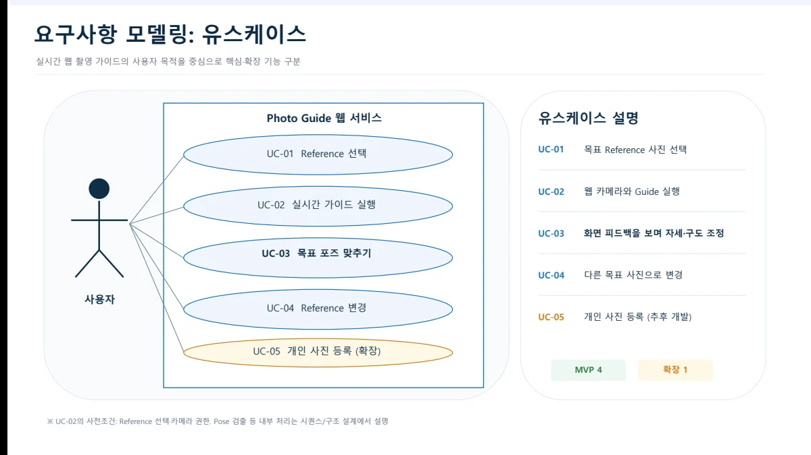
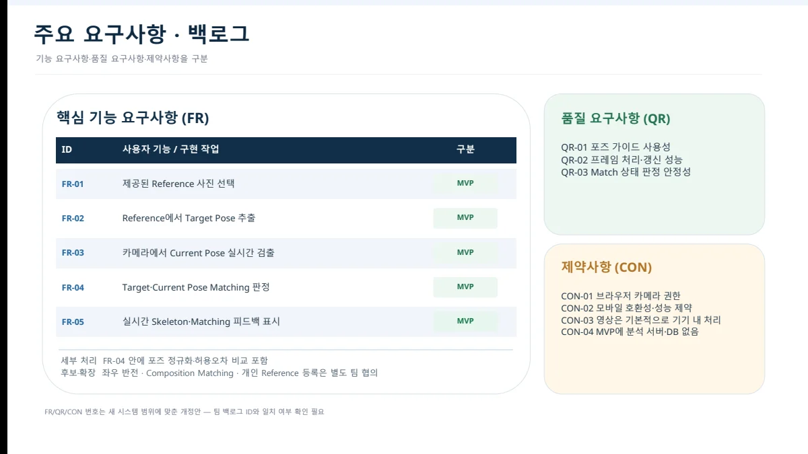
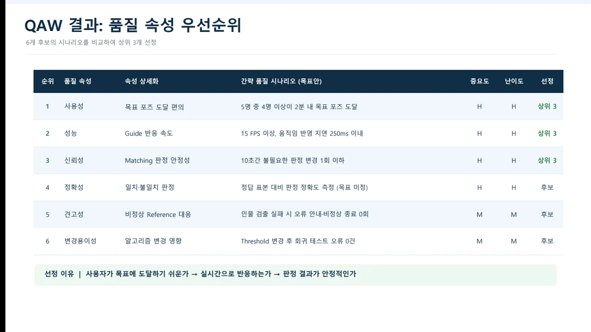
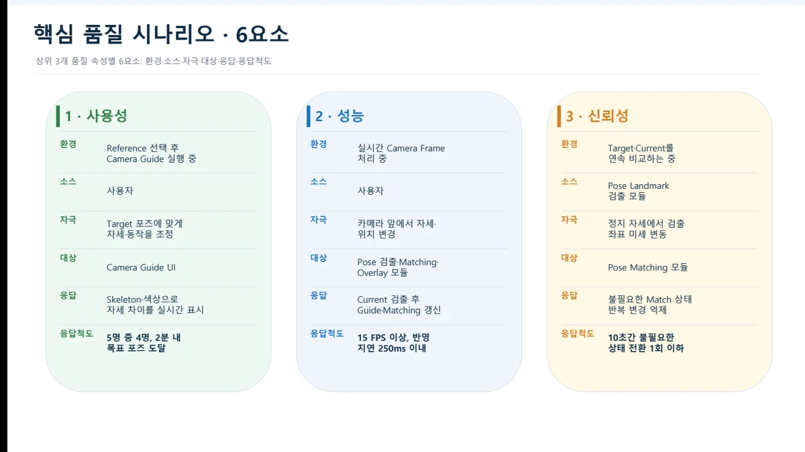
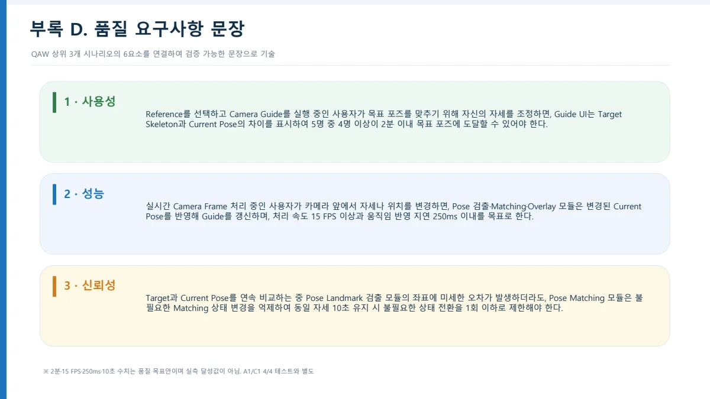

##### 참고 사진의 목표 포즈와 현재 카메라 포즈를 비교해 실시간으로 자세를 안내하는 웹 사진 촬영 가이드 서비스입니다.

  

#### 기능적 요구사항

* FR-01 · 사용자가 제공된 Reference 사진을 선택할 수 있어야 한다.
* FR-02 · Reference에서 목표 포즈(Target Pose)를 추출해야 한다.
* FR-03 · 카메라에서 현재 포즈(Current Pose)를 실시간으로 검출해야 한다.
* FR-04 · 목표 포즈와 현재 포즈의 일치 여부를 판정해야 한다. 포즈 정규화와 허용오차 비교를 포함한다.
* FR-05 · 실시간 Skeleton과 Matching 피드백을 표시해야 한다.

#### 보류·확장 범위

* 좌우 반전, 전체 구도 비교(Composition Matching), 개인 Reference 등록은 후보·확장 범위로 별도 협의한다.

#### 품질적 요구사항

* QR-01 · 사용자 5명 중 4명 이상이 2분 이내에 목표 포즈에 도달할 수 있어야 한다.
* QR-02 · 가이드 처리 속도는 15 FPS 이상, 움직임 반영 지연은 250ms 이내여야 한다.
* QR-03 · 동일 자세를 10초간 유지할 때 불필요한 Match 상태 전환을 1회 이하로 제한해야 한다.

#### 제약사항

* CON-01 · 브라우저의 카메라 사용 권한이 필요하다.
* CON-02 · 모바일 브라우저의 호환성과 성능 제약을 고려해야 한다.
* CON-03 · 영상은 기본적으로 사용자 기기 내에서 처리해야 한다.
* CON-04 · 1차 MVP에는 분석 서버와 데이터베이스를 두지 않는다.

품질 수치는 제출자료에 제시된 개발 목표이며, 구현 완료 또는 실측 달성을 뜻하지 않습니다.

 

#### UseCase Diagram

 

#### 발표자료

* [중간발표 자료 PDF 보기](/documents/2026/chal-kak/presentation.pdf)
* [원본 PowerPoint 다운로드](/documents/2026/chal-kak/presentation.pptx)

요구사항 출처 확인

기능·품질·제약: 6번 슬라이드. 품질 목표 수치: 9~10번·20번 슬라이드. FR/QR/CON 번호는 발표자료의 개정안 표기이며 팀 백로그와 대조가 필요하다고 명시되어 있습니다.

6번 슬라이드 원문 보기

9번 슬라이드 원문 보기

10번 슬라이드 원문 보기

20번 슬라이드 원문 보기

