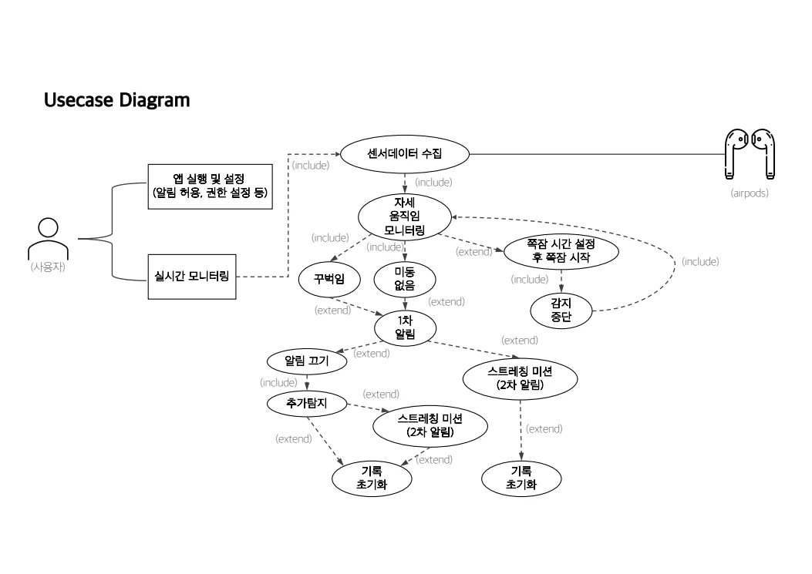
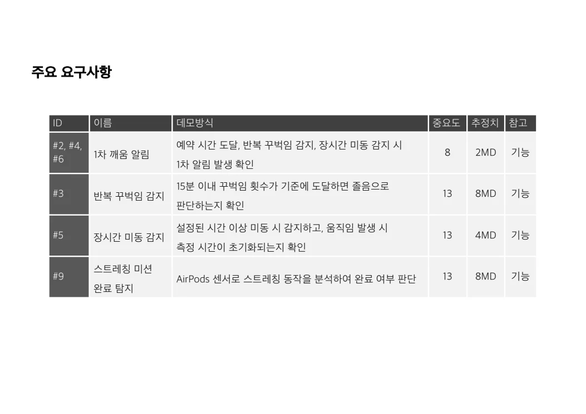
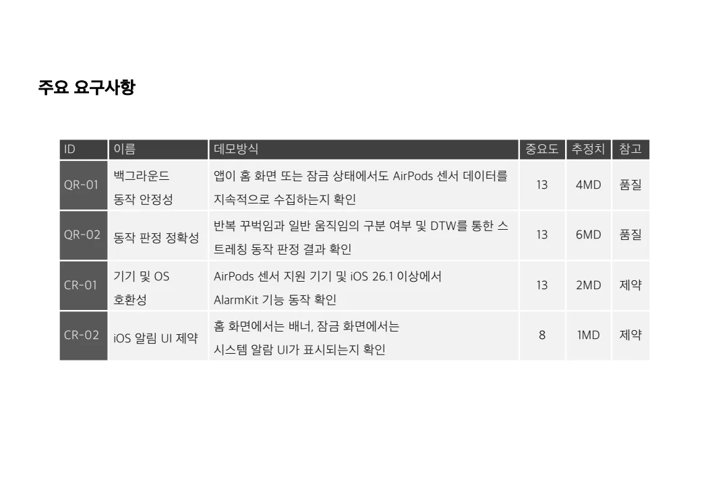
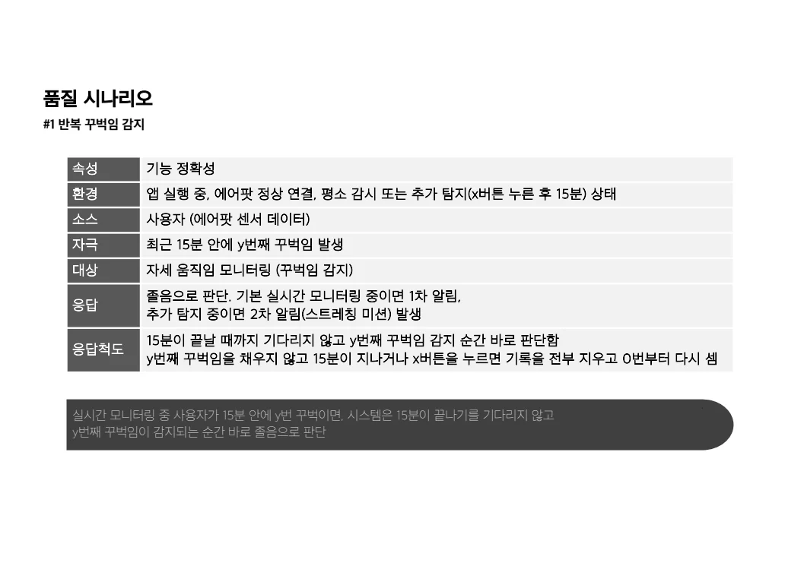
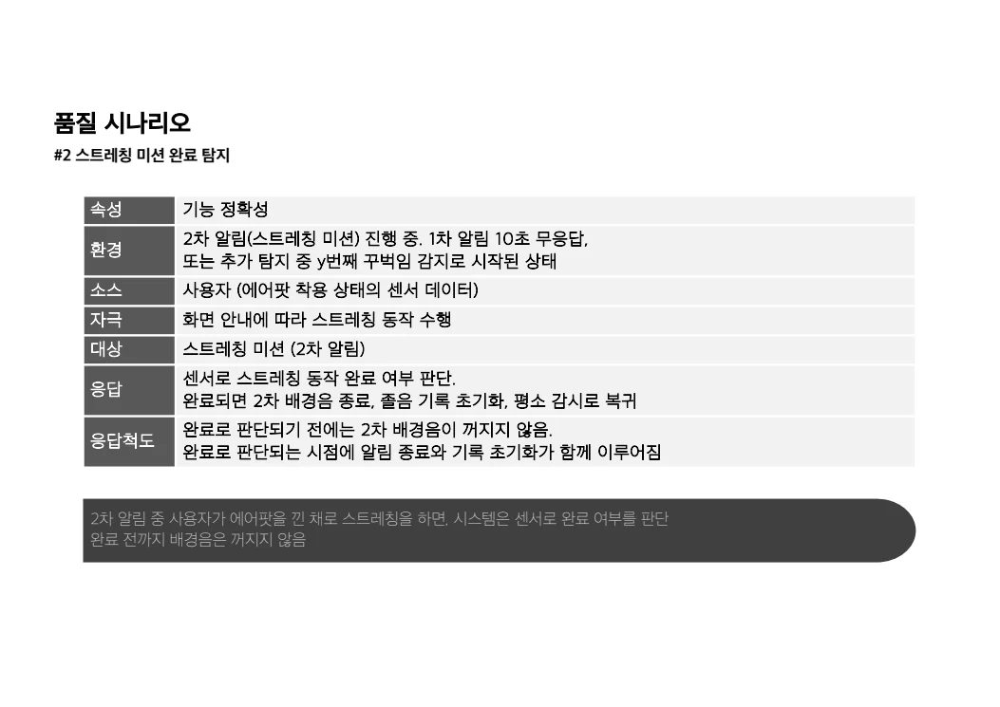
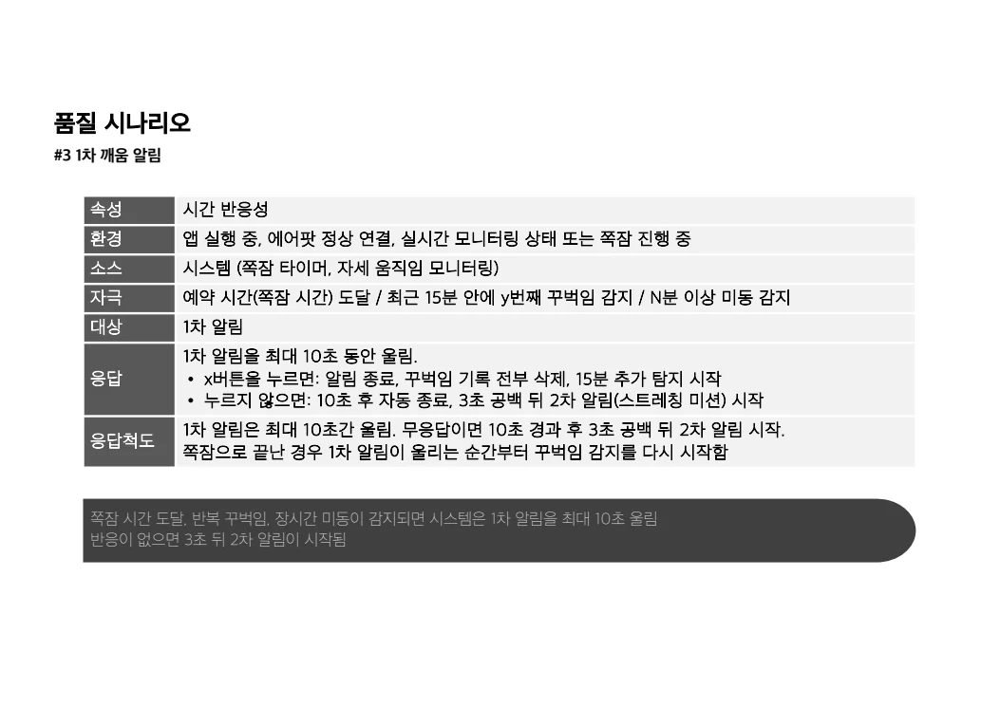

##### AirPods의 움직임 센서로 졸음 징후를 감지하고 깨움 알림과 스트레칭 미션으로 집중 회복을 돕는 iOS 앱입니다.

  

#### 기능적 요구사항

* 예약한 쪽잠 시간이 되거나 반복 끄덕임·장시간 미동이 감지되면 1차 깨움 알림을 제공해야 한다.
* 15분 이내 끄덕임 횟수가 기준에 도달하면 졸음으로 판단해야 한다.
* 설정된 시간 이상 미동이 없으면 이를 감지하고, 움직임이 발생하면 측정 시간을 초기화해야 한다.
* AirPods 센서로 스트레칭 동작을 분석해 미션 완료 여부를 판정해야 한다.

#### 품질적 요구사항

* QR-01 · 앱이 홈 화면 또는 잠금 상태에 있어도 AirPods 센서 데이터를 지속적으로 수집해야 한다.
* QR-02 · 반복 끄덕임과 일반 움직임을 구분하고 DTW를 통해 스트레칭 동작을 정확하게 판정해야 한다.
* 품질 시나리오 · 최근 15분 내 끄덕임이 기준 횟수에 도달하면 15분이 끝나기를 기다리지 않고 즉시 졸음으로 판단해야 한다.
* 품질 시나리오 · 2차 알림 중 스트레칭 완료를 판정하기 전까지 알림음을 유지해야 한다.
* 품질 시나리오 · 1차 알림에 10초 동안 반응이 없으면 3초의 대기 시간 뒤 2차 알림을 시작해야 한다.

#### 제약사항

* CR-01 · AirPods 센서를 지원하는 기기와 iOS 26.1 이상에서 AlarmKit 기능이 동작해야 한다.
* CR-02 · iOS의 알림 UI 제약에 따라 홈 화면에서는 배너, 잠금 화면에서는 시스템 알람 UI를 표시해야 한다.

품질 수치는 제출자료에 제시된 개발 목표이며, 구현 완료 또는 실측 달성을 뜻하지 않습니다.

 

#### UseCase Diagram

 

#### 발표자료

* [중간발표 자료 PDF 보기](/documents/2026/dailypods/presentation.pdf)

요구사항 출처 확인

기능: PDF 4쪽. 품질·제약: 5쪽. 상세 품질 시나리오: 9~11쪽. iOS 버전은 제출자료 표기를 유지했습니다.

4번 슬라이드 원문 보기

5번 슬라이드 원문 보기

9번 슬라이드 원문 보기

10번 슬라이드 원문 보기

11번 슬라이드 원문 보기

