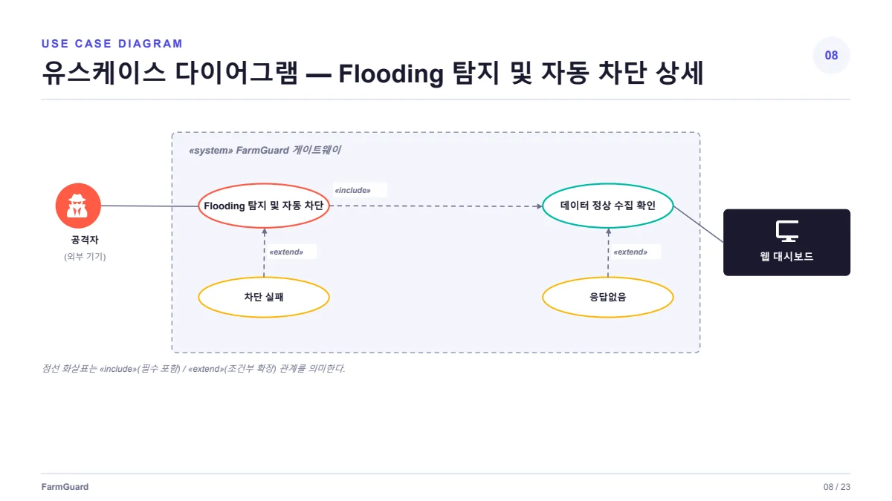
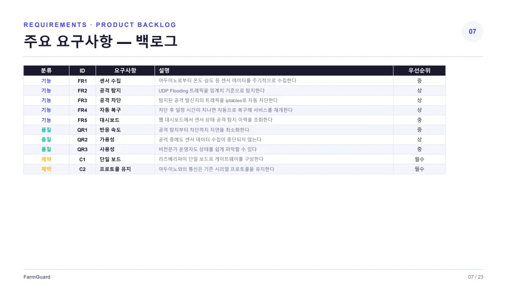
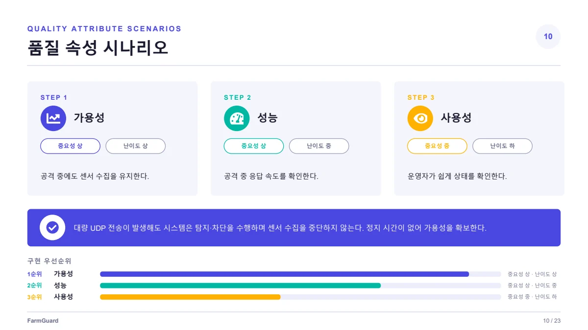

##### 스마트팜 게이트웨이의 UDP Flooding 공격을 탐지·차단하고 자동 복구하는 보안 소프트웨어입니다.

  

#### 기능적 요구사항

* FR1 · 아두이노로부터 온도·습도 등 센서 데이터를 주기적으로 수집해야 한다.
* FR2 · UDP Flooding 트래픽을 임계치 기준으로 탐지해야 한다.
* FR3 · 탐지된 공격 발신지의 트래픽을 iptables로 자동 차단해야 한다.
* FR4 · 차단 후 일정 시간이 지나면 자동으로 복구해 서비스를 재개해야 한다.
* FR5 · 웹 대시보드에서 센서 상태와 공격 탐지 이력을 조회할 수 있어야 한다.

#### 품질적 요구사항

* QR1 · 공격 탐지부터 차단까지의 지연을 최소화해야 한다.
* QR2 · 공격 중에도 센서 데이터 수집이 중단되지 않아야 한다.
* QR3 · 비전문가 운영자도 상태를 쉽게 파악할 수 있어야 한다.

#### 제약사항

* C1 · 라즈베리파이 단일 보드로 게이트웨이를 구성해야 한다.
* C2 · 아두이노와의 통신은 기존 시리얼 프로토콜을 유지해야 한다.

품질 수치는 제출자료에 제시된 개발 목표이며, 구현 완료 또는 실측 달성을 뜻하지 않습니다.

 

#### UseCase Diagram

 

#### 발표자료

* [중간발표 자료 PDF 보기](/documents/2026/farmguard/presentation.pdf)
* [원본 PowerPoint 다운로드](/documents/2026/farmguard/presentation.pptx)

요구사항 출처 확인

기능·품질·제약: 7번 슬라이드. 품질 시나리오: 10번 슬라이드.

7번 슬라이드 원문 보기

10번 슬라이드 원문 보기

