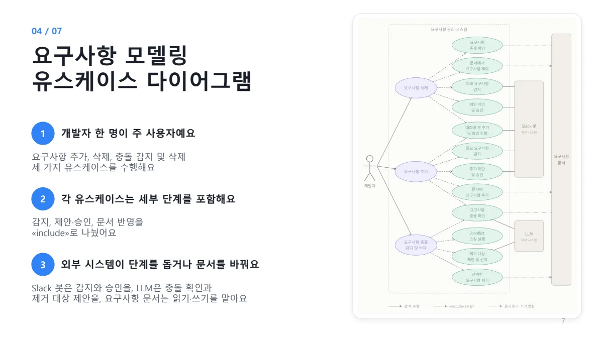
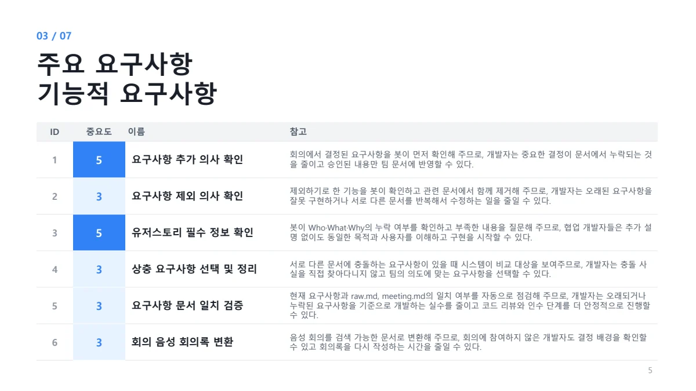
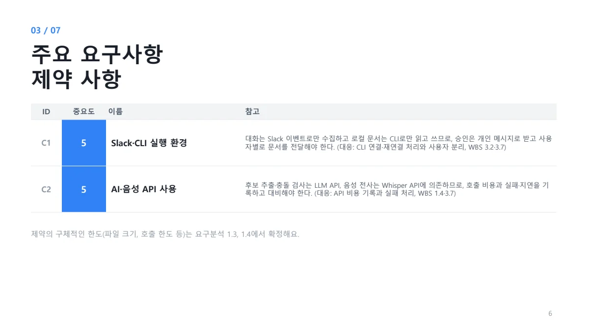
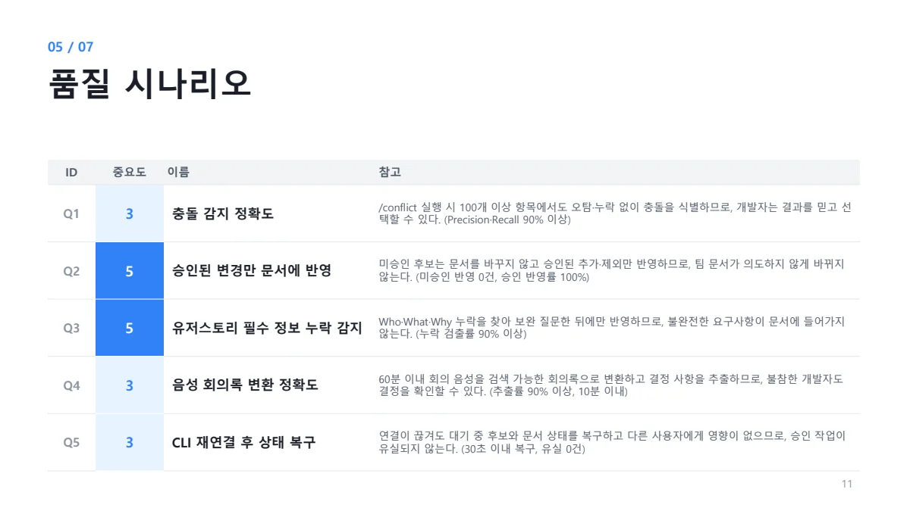

##### Slack 대화와 음성 회의록에서 요구사항을 추출하고 사용자 승인 후 문서에 반영하는 요구사항 관리 봇입니다.

  

#### 기능적 요구사항

* 회의에서 결정된 요구사항을 감지하고 추가 의사를 확인한 뒤 승인된 내용만 문서에 반영해야 한다.
* 제외하기로 한 요구사항의 삭제 의사를 확인하고 관련 문서에서도 함께 제거해야 한다.
* 유저스토리의 Who·What·Why 누락 여부를 확인하고 부족한 내용을 질문해야 한다.
* 상충되는 요구사항을 비교해 보여주고 사용자가 선택한 요구사항을 정리해야 한다.
* 현재 요구사항과 raw.md·meeting.md의 일치 여부를 자동으로 점검해야 한다.
* 음성 회의를 검색 가능한 회의록으로 변환하고 결정 배경을 확인할 수 있어야 한다.

#### 품질적 요구사항

* Q1 · 100개 이상 요구사항에서 충돌 판정 Precision과 Recall을 각각 90% 이상 유지해야 한다.
* Q2 · 미승인 변경의 문서 반영은 0건, 승인된 변경의 반영률은 100%여야 한다.
* Q3 · Who·What·Why 누락 검출률은 90% 이상이며, 보완 질문 없이 누락 상태로 반영되는 건수는 0건이어야 한다.
* Q4 · 60분 이내 회의 음성에 대해 핵심 결정 사항 추출률 90% 이상, 요청 후 10분 이내 회의록 제공을 목표로 한다.
* Q5 · CLI 재연결 후 30초 이내에 상태를 복구하고 승인 대기 후보가 유실되지 않아야 한다.

#### 제약사항

* C1 · 대화는 Slack 이벤트로 수집하고 로컬 문서는 CLI로 읽고 써야 한다. 승인은 개인 메시지로 받고 문서는 사용자별로 전달해야 한다.
* C2 · 요구사항 후보 추출·충돌 검사는 LLM API, 음성 전사는 Whisper API에 의존하므로 호출 비용과 실패·지연을 기록하고 대비해야 한다.
* 파일 크기·API 호출 한도 등 구체적인 제한은 요구 분석 단계에서 확정해야 한다.

품질 수치는 제출자료에 제시된 개발 목표이며, 구현 완료 또는 실측 달성을 뜻하지 않습니다.

 

#### UseCase Diagram

 

#### 발표자료

* [중간발표 자료 PDF 보기](/documents/2026/fastreqs/presentation.pdf)
* [원본 PowerPoint 다운로드](/documents/2026/fastreqs/presentation.pptx)

요구사항 출처 확인

기능: 5번 슬라이드. 제약: 6번 슬라이드. 품질: 11~16번 슬라이드.

5번 슬라이드 원문 보기

6번 슬라이드 원문 보기

11번 슬라이드 원문 보기

